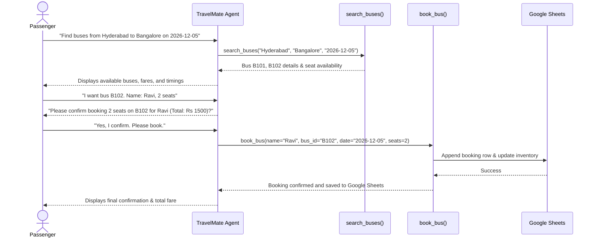

# Day 4: Autonomous Tool-Calling Agent & Google Sheets Integration

## 📌 Overview
Day 4 advances conversational AI into a fully autonomous, tool-calling **Agentic AI System**. Building on previous prompt-steering foundations, this module introduces **TravelMate**, a smart bus booking assistant capable of querying real-time bus catalogs, calculating dynamic fares, validating passenger inputs with **Pydantic**, requiring explicit user confirmation before state changes, and persisting finalized bookings directly to **Google Sheets**.

---

## 📂 Files
- [`task.py`](task.py): Complete agent implementation featuring custom tool definitions (`search_buses`, `book_bus`), Google Sheets synchronization via `gspread`, and multi-turn stateful conversation flow.

---

## 🎯 Key Concepts & Implementation

### 1. Tool-Calling Agent Architecture (`create_agent`)
- Powered by `ChatGroq(model="openai/gpt-oss-20b")` for rapid, deterministic reasoning.
- Equipped with custom tools using LangChain's `@tool` decorator:
  - **`search_buses(from_city, to_city, date)`**: Queries available bus routes, departure schedules, distances, per-seat pricing, and real-time seat availability.
  - **`book_bus(name, bus_id, date, seats)`**: Validates booking requests, deducts seat counts from inventory, calculates total fares, and logs the transaction.

### 2. Schema Validation with Pydantic
- Implements a strict `Booking` schema inheriting from `pydantic.BaseModel`:
  ```python
  class Booking(BaseModel):
      name: str = Field(description="Passenger name")
      bus_id: str = Field(description="Selected bus ID")
      date: str = Field(description="Journey date in YYYY-MM-DD")
      seats: int = Field(ge=1, description="Number of seats")
  ```
- Ensures parameter type safety and business logic constraints (e.g., minimum 1 seat) before external API calls.

### 3. Persistent Database Logging via Google Sheets
- Authenticates and interacts with Google Drive & Sheets using `gspread` and `google.auth`.
- Connects to an external spreadsheet, initializes column headers (`name`, `bus_id`, `from`, `to`, `date`, `seats`, `total`), and atomically appends confirmed booking records (`ws.append_row`).

### 4. Safety Guardrails & Confirmation Flow
- **Human-in-the-Loop Confirmation**: The system prompt explicitly enforces collecting all booking details and prompting the user for clear confirmation before invoking the destructive/write action (`book_bus`).
- **Hallucination Prevention**: Restricts the agent to verified route facts returned by `search_buses`.

### 5. Multi-Turn Conversation Memory
- Maintains full dialog history using message arrays (`[{"role": "user", "content": ...}, ...]`), enabling the agent to retain passenger preferences across turns.

---

## 🔄 Conversation & Agent Execution Flow



---

## 🚀 Setup & Execution

### Prerequisites
Install the required packages:
```bash
pip install langchain langchain-core langchain-groq groq gspread google-auth pydantic
```

### Environment Variables & Authentication
1. **Groq API Key**:
   - **Windows (PowerShell)**:
     ```powershell
     $env:GROQ_API_KEY="your-groq-api-key"
     ```
   - **Linux / macOS**:
     ```bash
     export GROQ_API_KEY="your-groq-api-key"
     ```
2. **Google Cloud Authentication**:
   - In Google Colab: Handled automatically via `auth.authenticate_user()`.
   - In Local Environment: Configure a Google Cloud Service Account with Google Sheets API enabled and point `GOOGLE_APPLICATION_CREDENTIALS` to your credentials JSON.

### Run the Script
```bash
python task.py
```
