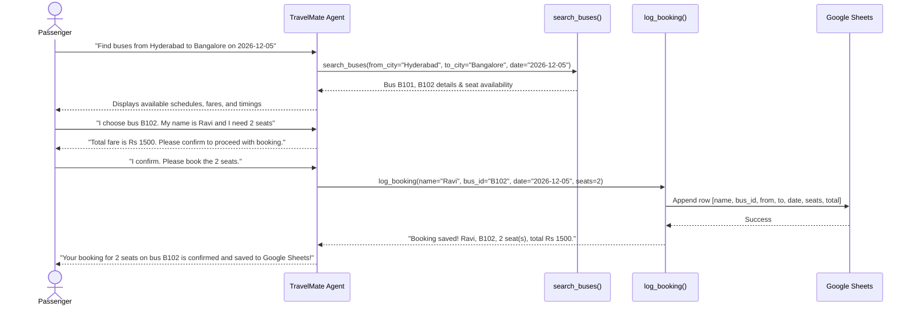

# Day 4: Autonomous Tool-Calling Agent, Structured Outputs & Google Sheets Integration

## 📌 Overview
Day 4 advances conversational AI into a production-grade, autonomous **Agentic AI System**. Implementing **TravelMate** (a bus booking assistant powered by `ChatGroq`), this module integrates deterministic tools for bus searching, structured entity extraction using **Pydantic** with `Literal` types, persistent transaction logging to **Google Sheets** via `gspread`, explicit confirmation safety guardrails, and message-trace observability for evaluating tool-call metrics.

---

## 📂 Files
- [`task.py`](task.py): Complete Python implementation featuring Pydantic schemas, custom LangChain tools (`search_buses`, `log_booking`), structured output parsing, multi-turn stateful agent conversations, Google Sheets persistence, and tool invocation analytics.

---

## 🎯 Key Concepts & Implementation

### 1. External Database Integration (Google Sheets via `gspread`)
- Connects to a live Google Sheet using `gspread` authorized via `google.auth`:
  ```python
  gc = gspread.authorize(creds)
  sh = gc.open_by_key("1U5Xg1jj8vTuTFckpZ4BGfbXK4EMbTxcMCpY60VuPum4")
  ws = sh.sheet1
  ```
- Automatically initializes column headers if empty:
  `["name", "bus_id", "from", "to", "date", "seats", "total"]`

### 2. Strict Schema Validation with Pydantic & `Literal`
- Defines a robust `Booking` model enforcing exact bus IDs and minimum seat constraints:
  ```python
  class Booking(BaseModel):
      name: str = Field(description="Passenger full name")
      bus_id: Literal["B101", "B102", "B103"] = Field(description="Selected bus ID")
      date: str = Field(description="Journey date in YYYY-MM-DD format")
      seats: int = Field(ge=1, description="Number of seats")
  ```
- Prevents invalid bus identifiers or negative/zero seat allocations before downstream execution.

### 3. Custom LangChain Tools (`@tool`)
- **`search_buses(from_city: str, to_city: str, date: str) -> str`**:
  - Searches deterministic catalog (`BUSES`) for matching routes and travel dates.
  - Returns departure time, route distance, per-seat fare, and only buses with available seats (`seats > 0`).
- **`log_booking(name: str, bus_id: str, date: str, seats: int) -> str`**:
  - Validates bus existence, schedule match, and remaining seat capacity.
  - Calculates the total fare (`fare * seats`).
  - Atomically appends the transaction row to Google Sheets (`ws.append_row`).
  - Decrements in-memory seat availability to prevent double-booking.

### 4. Structured Output Parsing (`llm.with_structured_output`)
- Demonstrates direct structured information extraction without agent overhead:
  ```python
  structured_llm = llm.with_structured_output(Booking)
  record = structured_llm.invoke("Ravi wants two seats on bus B102 for 5 December 2026.")
  ```
- Reliably parses varied natural language inquiries into typed `Booking` objects.

### 5. Autonomous Multi-Turn Agent (`create_agent`)
- Configured with `ChatGroq(model="openai/gpt-oss-20b", temperature=0.2)` and tools `[search_buses, log_booking]`.
- **System Prompt & Safety Guardrails**:
  - Requires collecting all necessary details (passenger name, bus ID, travel date, seat quantity).
  - Enforces calculating and presenting the total fare to the passenger.
  - **Human-in-the-Loop Confirmation**: Calls `log_booking` *only* after explicit confirmation from the customer.
- **Conversational Memory**: Maintains state across dialog turns using accumulated message history.

### 6. Observability, Message Tracing & Tool Call Metrics
- Inspects message chains with `msg.pretty_print()` to visualize reasoning steps, tool requests, and tool outputs.
- Quantifies agent performance by programmatically counting:
  - **Tool calls**: `sum(len(getattr(msg, "tool_calls", [])) for msg in messages)`
  - **Model responses**: `sum(1 for msg in messages if msg.type == "ai")`

---

## 🔄 Conversation & Agent Execution Flow



---

## 🚀 Setup & Execution

### Prerequisites
Install required dependencies:
```bash
pip install langchain langchain-core langchain-groq groq gspread google-auth pydantic
```

### Environment Variables & Credentials
1. **Groq API Key**:
   - **Windows (PowerShell)**:
     ```powershell
     $env:GROQ_API_KEY="your-groq-api-key"
     ```
   - **Linux / macOS**:
     ```bash
     export GROQ_API_KEY="your-groq-api-key"
     ```

2. **Google Cloud / Sheets Authentication**:
   - **In Google Colab**: Handled automatically via `auth.authenticate_user()`.
   - **In Local Environments**: Use a Google Cloud Service Account with Google Sheets and Google Drive APIs enabled, and ensure credentials are provided via `GOOGLE_APPLICATION_CREDENTIALS`.

### Run the Script
```bash
python task.py
```
