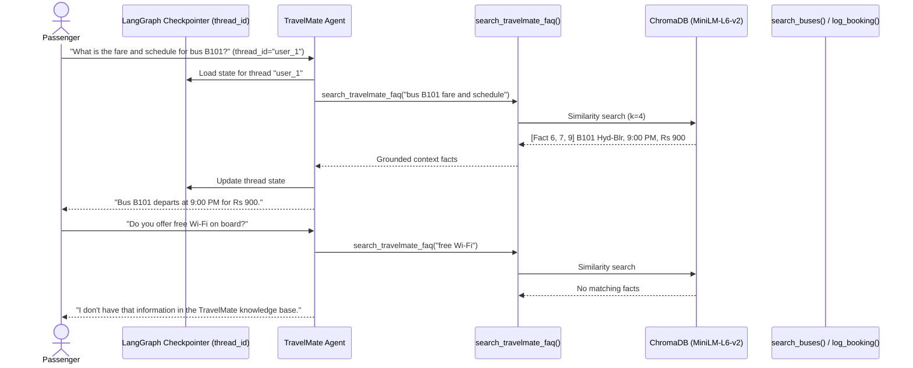

# Day 5: Retrieval-Augmented Generation (RAG), ChromaDB & Threaded Agent Memory

## 📌 Overview
Day 5 elevates the **TravelMate** autonomous agent into a knowledge-grounded **RAG (Retrieval-Augmented Generation)** system. This module introduces dense semantic retrieval using **ChromaDB** and HuggingFace embeddings (`all-MiniLM-L6-v2`), multi-session thread memory using **LangGraph's InMemorySaver**, hallucination prevention guardrails with explicit refusal policies, and an automated quantitative evaluation harness testing both factual retrieval and out-of-scope refusals.

---

## 📂 Files
- [`task.py`](task.py): Complete Python implementation featuring ChromaDB vector store setup, semantic retrieval tool (`search_travelmate_faq`), LangGraph thread checkpointer, multi-user isolation, and automated evaluation benchmarking.

---

## 🎯 Key Concepts & Implementation

### 1. Vector Database & Semantic Embeddings (ChromaDB)
- **Embedding Model**: `sentence-transformers/all-MiniLM-L6-v2` loaded locally via `langchain_huggingface` with normalized vectors on CPU.
- **Knowledge Base**: 20 canonical business facts (`TRAVELMATE_FACTS`) indexed into ChromaDB with metadata tags (`fact_number`, `business`).
- **Retriever**: Configured with top-$k$ similarity search ($k=4$) to fetch the most relevant context chunks for answering queries.

### 2. Knowledge Retrieval Tool (`search_travelmate_faq`)
- Integrated into the agent as an accessible LangChain `@tool`:
  ```python
  @tool
  def search_travelmate_faq(question: str) -> str:
      """Search TravelMate business knowledge about bus search requirements,
      passenger booking details, confirmation rules, demo bus IDs B101/B102/B103..."""
  ```
- Formats retrieved document chunks with clear citation headers (`[Fact 1] ...`, `[Fact 2] ...`) for traceable grounded answers.

### 3. Stateful Thread Isolation with LangGraph Memory
- Employs `InMemorySaver` from `langgraph.checkpoint.memory` passed directly to `create_agent`:
  ```python
  checkpointer = InMemorySaver()
  agent = create_agent(
      model=llm,
      tools=[search_buses, log_booking, search_travelmate_faq],
      system_prompt=DAY5_SYSTEM,
      checkpointer=checkpointer
  )
  ```
- **Thread Isolation**: Isolates conversation state across distinct users via `thread_id` (e.g., `travelmate_user_1` vs `travelmate_user_2`), ensuring private context histories that do not leak across sessions.

### 4. Hallucination Guardrails & Refusal Rules
- **Strict Grounding**: The system prompt prohibits inventing amenities, refund policies, payment methods, or external web lookups.
- **Controlled Refusal**: If a query falls outside the knowledge base, the agent is strictly required to refuse:
  > *"I don't have that information in the TravelMate knowledge base."*

### 5. Automated Evaluation & Sign-off Harness
- **Retrieval Benchmark**: 10 automated unit tests asserting mandatory keyword recall from the retriever.
- **Refusal Benchmark**: 4 negative test cases evaluating polite refusal on out-of-scope inquiries (Wi-Fi, refunds, payment types, meals).
- **Target Sign-Off**: Computes combined retrieval and refusal pass rates against an **$\ge 80\%$** benchmark threshold.

---

## 🔄 RAG Agent Architecture & Flow



---

## 🚀 Setup & Execution

### Prerequisites
Install the required dependencies:
```bash
pip install langchain langchain-core langchain-groq langchain-chroma langchain-huggingface chromadb sentence-transformers langgraph pydantic gspread google-auth
```

### Environment Variables
Set your Groq API key:
- **Windows (PowerShell)**:
  ```powershell
  $env:GROQ_API_KEY="your-groq-api-key"
  ```
- **Linux / macOS**:
  ```bash
  export GROQ_API_KEY="your-groq-api-key"
  ```

### Run the Script
```bash
python task.py
```
